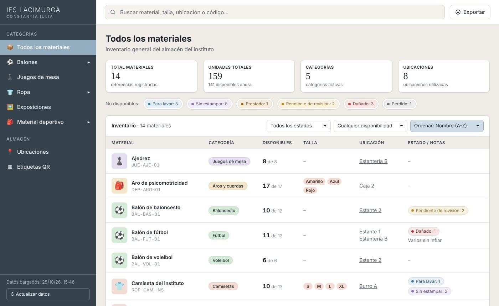
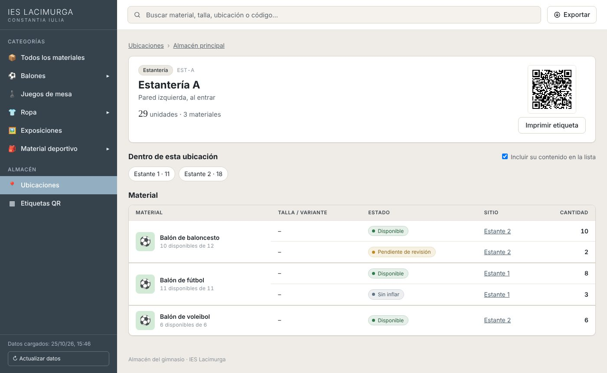
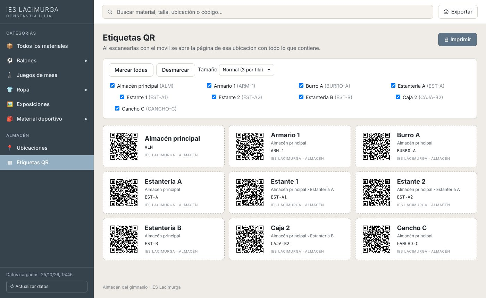
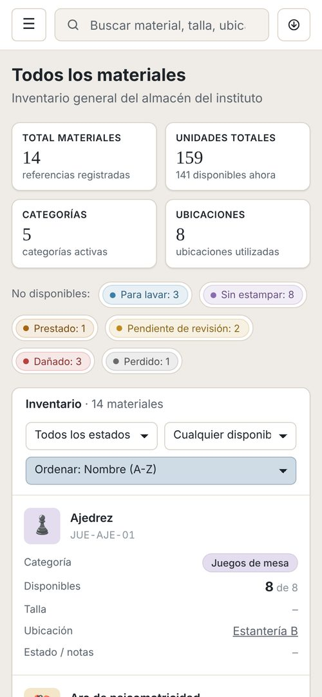

<div align="center">
  
</div>

<div align="center">
  <a href="https://ieslacimurga.github.io/inventario-gimnasio/" target="_blank"></a>
  <a href="https://www.figma.com/design/wk6avKTmmMpyyWOytJhW6S/inventario" target="_blank"></a>
  <a href="MANUAL.md"></a>
</div>

<div align="center">
  <a href="https://git.io/typing-svg"></a>
</div>

> [!NOTE]
> Este es el **repositorio oficial** del inventario: el que publica la web que usa el centro. Si encuentras un fallo o quieres proponer un cambio, hazlo aquí.

# 🚀 Sobre el Proyecto

**Inventario del Gimnasio** es la web que usa el **IES Lacimurga** para saber qué material hay en el almacén del gimnasio: cuántas unidades, de qué talla, en qué estado y en qué estantería está. Cada estantería, armario o caja lleva una **etiqueta QR**; al escanearla con el móvil se abre su página con todo lo que contiene.

Los profesores mantienen el inventario en una **hoja de Google Sheets** que ya saben usar, y la web la lee y calcula todos los totales. No hay servidor, ni base de datos, ni cuentas de usuario, así que **no cuesta nada** y **no guarda datos de alumnos**.

<div align="center">
  
  <p><em>Vista general del inventario (con los datos de ejemplo)</em></p>
</div>

✨ **Características principales:**

*   🔎 **Buscador y filtros:** Búsqueda por nombre, talla, ubicación o código, filtros por estado y disponibilidad, y navegación por categorías y subcategorías.
*   🧮 **Cantidades siempre cuadradas:** Las unidades solo se escriben una vez (material + talla + ubicación + estado) y la web calcula todos los totales: disponibles, por talla, por estado y por ubicación.
*   🏷️ **Estados configurables:** *Disponible*, *Para lavar*, *Dañado*, *Prestado*… cada uno decide si cuenta como disponible.
*   📍 **Ubicaciones anidadas con QR:** Almacén → estantería → estante → caja. Cada ubicación tiene su QR y se pueden imprimir todas las etiquetas a la vez, en varios tamaños.
*   📤 **Exportar a Excel** e **imprimir** con estilos propios para papel.
*   🩺 **Revisión de datos:** Si en la hoja hay un error (un material que no existe, una cantidad negativa…), la web no se rompe: lo marca e indica la fila.
*   📱 **PWA:** Se instala como app en el móvil y, si no hay conexión, muestra la última copia descargada.
*   🔐 **Segura por diseño:** Solo lectura, CSP, todo el texto se muestra como texto (protección XSS), fotos limitadas a rutas propias o `https` y exportación protegida contra inyección de fórmulas.
*   🧪 **26 pruebas automáticas** con el test runner de Node, incluida una que comprueba que los QR generados se leen bien.

### Galería de Funcionalidades

| Página de una ubicación | Etiquetas QR |
| :---------------------: | :----------: |
|  |  |
| *Lo que se ve al escanear el QR de una estantería.* | *Selección de ubicaciones y tamaño antes de imprimir.* |

<div align="center">
  
  <p><em>En el móvil, la tabla se convierte en fichas</em></p>
</div>

# 🧠 Contexto del Proyecto

Es un **proyecto real** para el departamento de Educación Física del **IES Lacimurga**, que necesitaba controlar el material del almacén del gimnasio. Las condiciones eran claras: **coste cero**, **seguro** y que **los datos de los alumnos no salieran del centro**.

La desarrollé de forma desinteresada como antigua alumna del centro. Diseñé primero los wireframes en **Figma** y, tras valorar una primera versión con servidor y sistema de préstamos, decidí simplificarla a una **web estática**. Sin préstamos ni cuentas no hace falta guardar ningún dato personal, y Google Sheets aporta gratis los permisos (solo editan los profesores) y el historial de cambios. Los motivos de cada decisión están en el [manual](MANUAL.md#11-decisiones-y-limitaciones).

```
 Profesores ──editan──▶ Hoja de Google Sheets (5 pestañas)
                               │  «Publicar en la web» (solo lectura, CSV)
                               ▼
 Cualquiera ──abre──▶ Web en GitHub Pages ──descarga las pestañas y calcula los totales
```

# 🛠️ Stack Tecnológico

<div align="center">
  
  
  
  
  
  
  
  
</div>

<br>

<div align="center">

| Área | Tecnología |
| :--- | :--------- |
| **Frontend** | `HTML5`, `CSS3` (responsive e impresión), `JavaScript` con módulos ES, sin frameworks |
| **Datos** | `Google Sheets` publicado como CSV (5 pestañas), con datos de ejemplo en `datos/` |
| **QR** | Generador propio en `js/qr.js`, sin dependencias |
| **App** | `manifest.webmanifest` + `service worker` (instalable y sin conexión) |
| **Pruebas** | `node --test` (Node.js 18+) |
| **Despliegue** | `GitHub Pages` |
| **Diseño** | Wireframes en `Figma` |

</div>

# 📂 Estructura del Proyecto

```bash
inventario-gimnasio/
├── index.html               # Página única de la web
├── css/estilos.css          # Escritorio, tablet, móvil e impresión
├── js/
│   ├── config.js            # ← Configuración: lo único que hay que editar
│   ├── app.js               # Interfaz: vistas, buscador, filtros, exportar y etiquetas
│   ├── datos.js             # Modelo de datos y cálculo de cantidades (sin interfaz, probado)
│   ├── carga.js             # Descarga de las pestañas y copia local sin conexión
│   ├── csv.js               # Lectura y exportación de CSV
│   └── qr.js                # Generador de códigos QR
├── datos/*.csv              # Datos de ejemplo
├── plantilla/*.xlsx         # Plantilla para crear la hoja de Google
├── img/                     # Iconos, logo y fotos de los materiales
├── manifest.webmanifest     # Instalación como app
├── sw.js                    # Uso sin conexión
├── tests/                   # Pruebas automáticas
├── MANUAL.md                # Puesta en marcha y uso diario
└── README.md
```

# 🚀 Cómo Utilizar el Proyecto

### 1. Verla online

**[ieslacimurga.github.io/inventario-gimnasio](https://ieslacimurga.github.io/inventario-gimnasio/)**

### 2. Ponerla en marcha para otro centro

El [manual](MANUAL.md#2-puesta-en-marcha-paso-a-paso) explica paso a paso cómo crear la hoja desde la plantilla, publicarla, configurar `js/config.js` y activar GitHub Pages. El [uso diario](MANUAL.md#3-uso-diario-profesores) para los profesores está en el mismo documento.

### 3. Probarla en local

1.  Clona el repositorio:
    ```bash
    git clone https://github.com/IESLACIMURGA/inventario-gimnasio.git
    ```
2.  Navega a la carpeta del proyecto:
    ```bash
    cd inventario-gimnasio
    ```
3.  Levanta un servidor (los módulos de JavaScript no funcionan con doble clic) y abre `http://localhost:8000`:
    ```bash
    python -m http.server 8000
    ```
    Para usar los datos de ejemplo en lugar de la hoja real, pon `fuente: 'demo'` en `js/config.js`.

### 4. Ejecutar las pruebas

```bash
node --test tests/*.test.mjs
```

<br>

<div align="center">
  <p>Creado por <strong>Eva Gallardo</strong></p>
  <a href="https://github.com/evagr11" target="_blank">
    
  </a>
  <a href="https://www.linkedin.com/in/eva-gallardo-romero-830362349/" target="_blank">
    
  </a>
  <p><sub>Para el departamento de Educación Física del <a href="https://github.com/IESLACIMURGA">IES Lacimurga</a></sub></p>
</div>

<div align="center">
  
</div>
